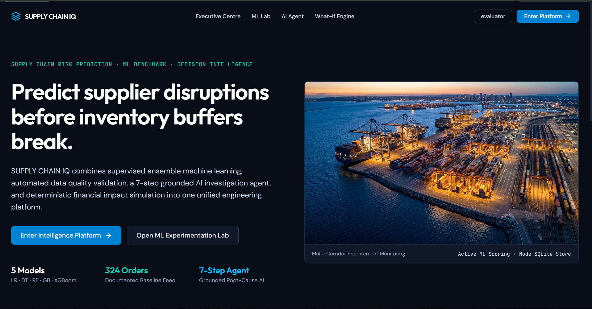
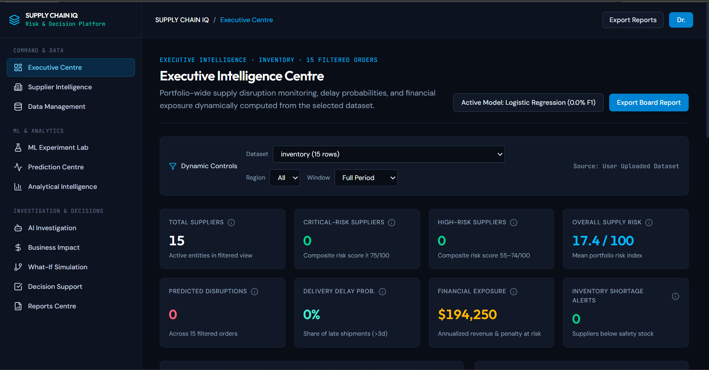
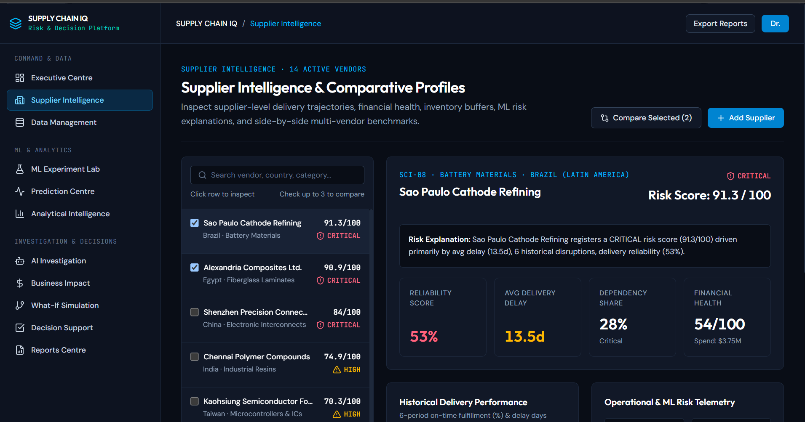
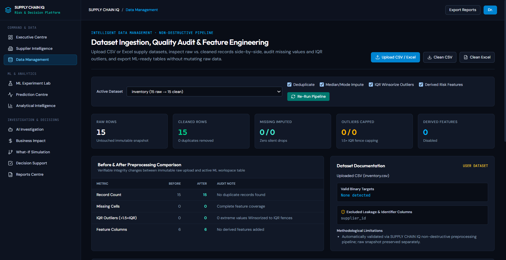
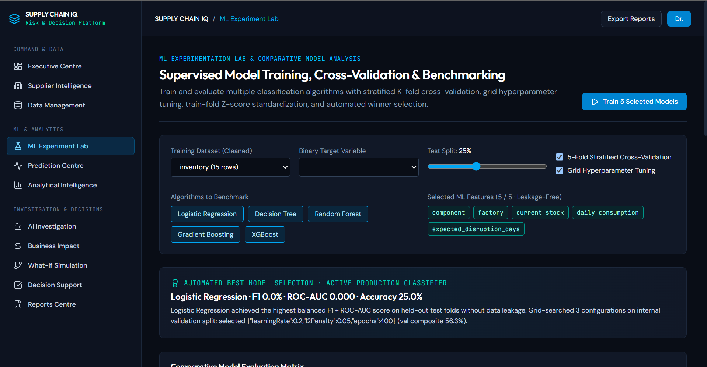
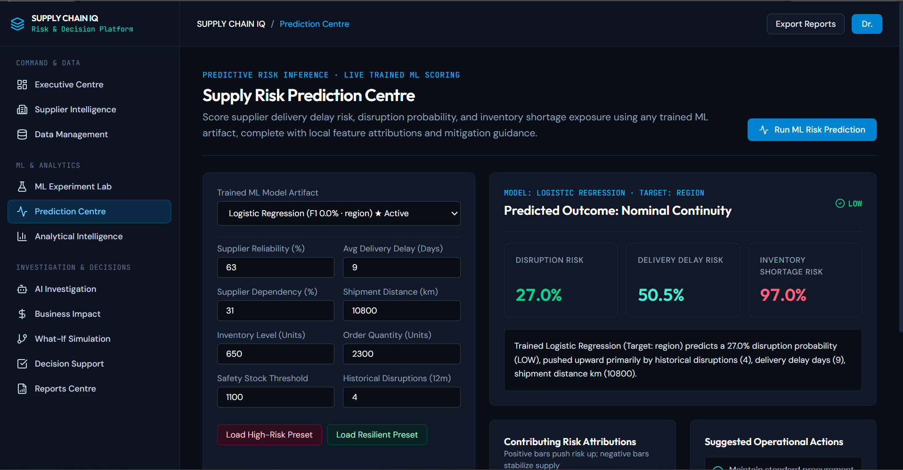
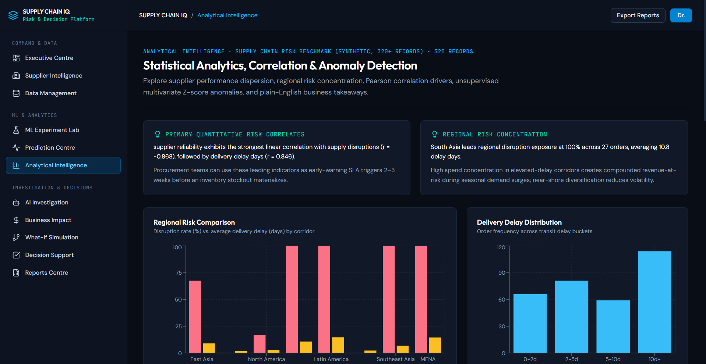
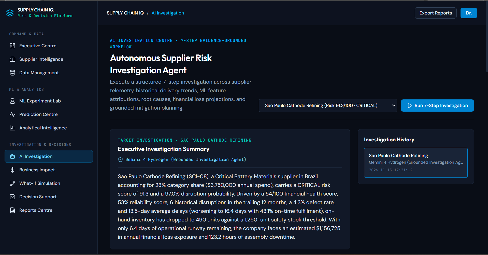
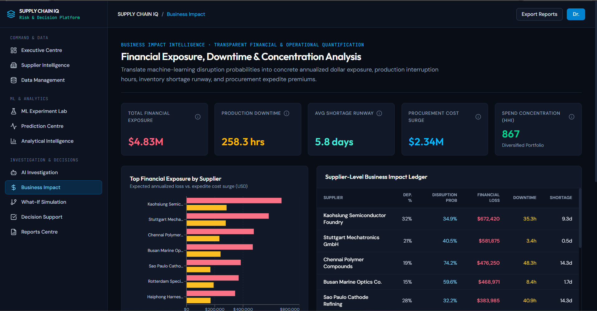
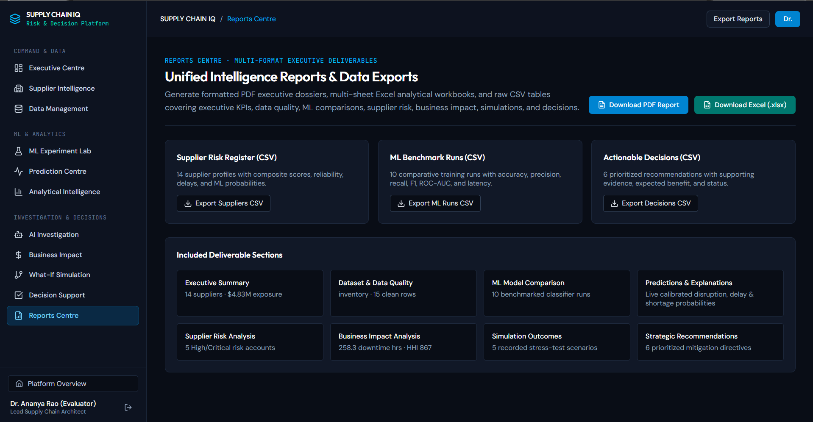

# 🚀 SUPPLYCHAIN IQ (SC-IQ)
### AI-Powered Supply Chain Risk & Decision Intelligence Platform

<div align="center">

**Transforming Supply Chain Complexity into Intelligent Business Decisions**

[🌐 Live Application](https://sc-iq.onrender.com/) • [📂 GitHub Repository](https://github.com/shreepriyasayam/SC-IQ)

</div>

---

## 📌 Project Overview

**SupplyChain IQ (SC-IQ)** is an AI-powered Supply Chain Risk and Decision Intelligence Platform designed to help organizations understand, monitor, analyze, and improve their supply chain operations.

Modern supply chains face challenges such as supplier uncertainty, operational disruptions, changing market conditions, data fragmentation, and business risks. SC-IQ brings multiple intelligence capabilities into one centralized platform to support better visibility and informed decision-making.

The application combines artificial intelligence, machine learning, predictive analytics, data management, risk analysis, interactive visualizations, and business intelligence.

Its purpose is to transform complex supply chain information into meaningful insights that support operational and strategic decisions.

### 🌐 Live Demo

| Resource | Link |
|---|---|
| Live Application | https://sc-iq.onrender.com/ |
| GitHub Repository | https://github.com/shreepriyasayam/SC-IQ |
| Main Branch | main |
| Deployment Platform | Render |

---

# 📸 Application Screenshots

Explore the different modules and interfaces of SupplyChain IQ.

## Platform Interface

<table>
<tr>
<td width="50%">

<p align="center"><b>01. Platform Landing Page</b></p>
</td>
<td width="50%">

<p align="center"><b>02. Executive Centre</b></p>
</td>
</tr>
<tr>
<td width="50%">

<p align="center"><b>03. Supplier Intelligence</b></p>
</td>
<td width="50%">

<p align="center"><b>04. Data Management</b></p>
</td>
</tr>
<tr>
<td width="50%">

<p align="center"><b>05. ML Experiment Lab</b></p>
</td>
<td width="50%">

<p align="center"><b>06. Prediction Centre</b></p>
</td>
</tr>
<tr>
<td width="50%">

<p align="center"><b>07. Analytical Intelligence</b></p>
</td>
<td width="50%">

<p align="center"><b>08. AI Investigation</b></p>
</td>
</tr>
<tr>
<td width="50%">

<p align="center"><b>09. Business Impact</b></p>
</td>
<td width="50%">

<p align="center"><b>10. Reports Centre</b></p>
</td>
</tr>
</table>

---

# ✨ Core Modules & Features

SC-IQ is organized into specialized modules, each designed to address a different aspect of supply chain intelligence.

## 1. Executive Centre

Provides a centralized view of supply chain information for executive-level monitoring and decision support.

**Key capabilities:**
- Executive-level overview.
- Supply chain performance visibility.
- Business intelligence.
- Centralized operational insights.
- Strategic decision support.

## 2. Supplier Intelligence

Focuses on supplier-related information and intelligence to support supplier evaluation and monitoring.

**Key capabilities:**
- Supplier information analysis.
- Supplier performance visibility.
- Supplier-related risk intelligence.
- Supplier decision support.

## 3. Data Management

Provides a centralized environment for working with supply chain datasets.

**Key capabilities:**
- Dataset management.
- Data import and processing.
- Structured data handling.
- Data preparation for analytical workflows.
- Dataset organization.

## 4. ML Experiment Lab

Provides an environment for machine learning experimentation and model-related workflows.

**Key capabilities:**
- Machine learning experimentation.
- Model exploration.
- Analytical experimentation.
- Model-related insights.

## 5. Prediction Centre

Supports predictive analysis to help identify potential supply chain outcomes.

**Key capabilities:**
- Predictive intelligence.
- Data-driven forecasting workflows.
- Prediction analysis.
- Decision-support insights.

## 6. Analytical Intelligence

Transforms available information into understandable analytical insights.

**Key capabilities:**
- Analytical dashboards.
- Data visualization.
- Interactive charts.
- Performance analysis.
- Business intelligence.

## 7. AI Investigation

Provides AI-assisted investigation capabilities for examining supply chain information.

**Key capabilities:**
- AI-assisted analysis.
- Investigation workflows.
- Intelligent information processing.
- Context-based insights.

## 8. Business Impact

Focuses on understanding the potential business implications of supply chain risks and operational changes.

**Key capabilities:**
- Business impact analysis.
- Risk and impact assessment.
- Operational implications.
- Decision-support information.

## 9. Simulation Centre

Provides a space for exploring supply chain scenarios and supporting scenario-based analysis.

**Key capabilities:**
- Scenario exploration.
- Simulation workflows.
- What-if analysis support.
- Operational decision exploration.

## 10. Decisions Centre

Connects analytical insights with business decision-making.

**Key capabilities:**
- Decision-support workflows.
- Analytical information for decisions.
- Strategic insights.
- Business-oriented evaluation.

## 11. Reports Centre

Provides reporting capabilities for communicating analytical findings.

**Key capabilities:**
- Report generation workflows.
- Analytical summaries.
- Export-oriented reporting.
- Organized reporting information.

---

# 🧠 AI & Machine Learning Intelligence

Artificial intelligence and machine learning are important components of the SC-IQ architecture.

The platform integrates Google's Gemini ecosystem through the Google GenAI SDK.

The AI and analytical components are organized to support:

- AI-assisted supply chain investigation.
- Intelligent information analysis.
- Machine learning experimentation.
- Predictive analytical workflows.
- Risk and impact assessment.
- Data-driven business intelligence.

The platform also includes dedicated engine components for data processing, machine learning models, and risk and impact analysis.

---

# 🏗️ System Architecture

SC-IQ follows a modular application structure that separates the user interface, backend functionality, and analytical engine components.

### High-Level Architecture

```text
              SUPPLYCHAIN IQ
                    |
                    |
             User Interface
                    |
          React + TypeScript
                    |
             Application
                 Pages
                    |
          Backend Services
                    |
          -------------------
          |        |        |
       Database   AI     Investigation
          |      Engine      Agent
          |
          -------------------
                    |
             Analytics Engine
                    |
          -------------------
          |        |        |
        Data      ML      Risk &
      Pipeline  Models    Impact
          |
          |
       Insights
          |
          |
     Decision Support
```

### Architecture Components

| Component | Responsibility |
|---|---|
| Frontend | Application interface and user interaction |
| Pages | Individual application modules |
| Backend | Server-side functionality |
| Database | Data storage and management |
| Data Pipeline | Data processing workflows |
| ML Models | Machine learning functionality |
| Risk & Impact Engine | Risk and business impact analysis |
| Investigation Agent | AI-assisted investigation functionality |

---

# 🛠️ Technology Stack

The project uses a modern TypeScript-based application stack.

## Frontend Technologies

| Technology | Purpose |
|---|---|
| React 19 | User interface development |
| TypeScript | Type-safe development |
| Vite | Development server and build tooling |
| Tailwind CSS 4 | Styling |
| Lucide React | Interface icons |
| Motion | Interface animations |

## Backend Technologies

| Technology | Purpose |
|---|---|
| Node.js | JavaScript runtime |
| Express.js | Backend server framework |
| TypeScript | Backend development |
| tsx | TypeScript execution |
| dotenv | Environment configuration |

## AI & Data Technologies

| Technology | Purpose |
|---|---|
| Google GenAI SDK | AI integration |
| Recharts | Data visualization |
| PapaParse | CSV data processing |
| XLSX | Spreadsheet processing |
| jsPDF | PDF generation |
| jsPDF AutoTable | PDF table generation |

## Security & Authentication Libraries

| Technology | Purpose |
|---|---|
| bcryptjs | Password hashing functionality |
| JSON Web Token | Token-based authentication functionality |

## Development & Deployment

| Technology | Purpose |
|---|---|
| Git | Version control |
| GitHub | Source code management |
| npm | Dependency management |
| Render | Application deployment |

---

# 📂 Project Structure

The project is organized into frontend, backend, engine, and data-related directories.

```text
SC-IQ/
│
├── data/
│   └── sciq_v2.db
│
├── src/
│   │
│   ├── assets/
│   │   └── images/
│   │
│   ├── backend/
│   │   ├── database.ts
│   │   ├── datasetSeed.ts
│   │   └── investigationAgent.ts
│   │
│   ├── engine/
│   │   ├── contracts.ts
│   │   ├── dataPipeline.ts
│   │   ├── mlModels.ts
│   │   └── riskAndImpact.ts
│   │
│   ├── pages/
│   │   ├── LandingPage.tsx
│   │   ├── ExecutivePage.tsx
│   │   ├── SuppliersPage.tsx
│   │   ├── DataManagementPage.tsx
│   │   ├── MLLabPage.tsx
│   │   ├── PredictionPage.tsx
│   │   ├── AnalyticsPage.tsx
│   │   ├── InvestigationPage.tsx
│   │   ├── BusinessImpactPage.tsx
│   │   ├── SimulationPage.tsx
│   │   ├── DecisionsPage.tsx
│   │   └── ReportsPage.tsx
│   │
│   └── ui/
│
├── .env.example
├── .gitignore
├── index.html
├── package.json
├── package-lock.json
├── server.ts
├── tsconfig.json
├── vite.config.ts
│
├── 00-platform-landing.png
├── 01-executive-centre.png
├── 02-supplier-intelligence.png
├── 03-data-management.png
├── 04-ml-experiment-lab.png
├── 05-prediction-centre.png
├── 06-analytical-intelligence.png
├── 07-ai-investigation.png
├── 08-business-impact.png
└── 09-reports-centre.png
```

---


# 📜 Available npm Scripts

| Command | Description |
|---|---|
| `npm run dev` | Starts the application server |
| `npm start` | Starts the application using tsx |
| `npm run build` | Builds the frontend for production |
| `npm run preview` | Previews the production build |
| `npm run clean` | Cleans generated build files |
| `npm run lint` | Runs TypeScript checking |

---

# 🚀 Deployment

SupplyChain IQ is deployed using Render.

### Live Application

🌐 https://sc-iq.onrender.com/

### Deployment Overview

The deployment workflow involves:

1. Maintaining the project source code in GitHub.
2. Connecting the repository to the deployment platform.
3. Configuring the required environment variables.
4. Building and deploying the application.
5. Accessing the deployed application through its public URL.

The production environment should be configured with the necessary API keys and application settings.

---

# 🔐 Security Considerations

Security is an important consideration when developing AI-powered applications.

Recommended practices include:

- Keep API keys private.
- Store sensitive configuration in environment variables.
- Never publish passwords or secret credentials.
- Use appropriate password hashing practices.
- Protect authentication tokens.
- Validate user-provided data.
- Configure production environment variables securely.

---

# 🎯 Project Objectives

The main objectives of SupplyChain IQ are:

1. Improve supply chain visibility.
2. Support supplier intelligence and evaluation.
3. Organize and process supply chain datasets.
4. Integrate AI-assisted investigation capabilities.
5. Support predictive analytical workflows.
6. Improve risk and impact understanding.
7. Provide interactive analytical insights.
8. Support scenario-based exploration.
9. Improve business decision-making.
10. Centralize supply chain intelligence in one platform.

---

# 🔮 Future Enhancements

Potential areas for future development include:

- Advanced predictive analytics.
- Real-time supply chain monitoring.
- Enhanced supplier risk intelligence.
- Advanced machine learning models.
- External supply chain data integrations.
- More comprehensive analytics dashboards.
- Automated risk alerts.
- Enhanced reporting and visualization.
- Advanced scenario simulation.
- Expanded AI-assisted investigation capabilities.

---

# 👩‍💻 Developer Information

**Project Name:** SupplyChain IQ (SC-IQ)

**Project Category:** Artificial Intelligence | Supply Chain Management | Decision Intelligence

**Developer:** Shree Priya Sayam

**GitHub Profile:** https://github.com/shreepriyasayam

**Repository:** https://github.com/shreepriyasayam/SC-IQ

**Live Project:** https://sc-iq.onrender.com/

---

# 📄 License

No separate open-source license has been specified in this project documentation. All rights and permissions should be determined by the repository owner.

---

<div align="center">

# 🚀 SUPPLYCHAIN IQ

### Smarter Supply Chains. Intelligent Decisions.

**AI-Powered Supply Chain Risk & Decision Intelligence Platform**

[🌐 Visit Live Application](https://sc-iq.onrender.com/)

Developed by **Shree Priya Sayam**

</div>
